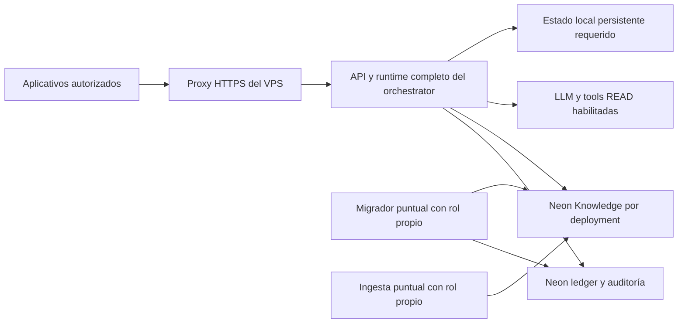

# Plan de ejecución del despliegue en el VPS de pruebas

Fecha: 2026-11-11 (America/Bogota). Estado: planificación preparada; ejecución pendiente.
Base inspeccionada: `main`, commit `5a7df31`, con cambios documentales locales. No se construyó una imagen ni se modificó el servidor durante esta planificación.

## Objetivo y relación con PLAN-VPS

Este documento convierte el diagnóstico de [PLAN-VPS.md](PLAN-VPS.md) en trabajo ordenado y verificable. El destino inicial es el VPS de pruebas de la empresa: `hector@2.24.201.39`, hostname observado `srv2113451`, Ubuntu 24.04 `x86_64`. El acceso SSH por clave y la presencia de Docker y Git están verificados; capacidad, configuración y servicios coexistentes requieren inventario.

El resultado esperado es el **orchestrator completo**, ejecutado autónomamente en el VPS y consumido mediante API: runtime, políticas, ledger, auditoría durable, tools READ y retrieval Knowledge. Neon permanece externo, con roles separados. La composición concreta del proceso HTTP es un entregable previo al despliegue. El gateway Orbit actual y el probe E3 no acreditan por sí solos ese resultado.

Se conserva la opción A de [ADR-ORCH-024](../../adr/ADR-ORCH-024-DEPLOYMENT-TOPOLOGY.md): una instancia de aplicación, migrador puntual y trabajos de ingesta separados. El VPS es de pruebas; pasar a tráfico operativo requiere evidencia y aceptación. La planificación no cierra E3-0, E3-5 ni E3-6.

## Contraste del diagnóstico con el repositorio actual

| Bloqueo de PLAN-VPS | Evidencia actual | Trabajo y fase |
| --- | --- | --- |
| 1. Secretos | La comprobación de `.env.example` ya no encuentra el patrón de token Telegram descrito. Esto no demuestra revocación de valores históricos. | P0: confirmar tratamiento de exposición previa; P3: credenciales propias de pruebas y entrega segura. |
| 2. Compose local | `compose.yaml` sigue siendo D0: PostgreSQL local, fake, reinicio desactivado y salida sin NAT. | P3–P4: crear manifiesto VPS independiente, sin alterar el baseline D0. |
| 3. Cuotas de prueba | `composition.py` sigue construyendo `MonthlyCallLimiter`. | P1: definir y conectar cuotas operativas, conservando protección de pruebas. |
| 4. Tokens | `REAL_MAX_OUTPUT_TOKENS=128`; el gateway admite configurar hasta 512. | P1: unificar validación, contrato y configuración. |
| 5. Servidor HTTP | Entradas actuales basadas en `http.server`; D0 no tiene autenticación productiva. | P1: definir servidor y contrato de ingreso; P4: proxy HTTPS y límites de borde. |
| 6. Readiness/concurrencia | `/readyz` del gateway devuelve éxito constante. | P1: readiness con dependencias y drenaje; P5–P6: comprobar carga y admisión. |
| 7. Apagado | El diagnóstico identifica drenaje menor que el timeout LLM. | P1: alinear deadlines; P4: período de parada con margen; P6: SIGTERM bajo carga. |
| 8. Estado local | Presupuesto y SQLite, si se habilita Telegram, necesitan persistencia. | P3–P5: volumen escribible, permisos UID/GID 10001 y recuperación. |
| 9. Migraciones | `http/migrate.py` aplica solo `001` y `006`; existen SQL PostgreSQL `001`–`008` y Knowledge `001`–`002`. | P2: runner con cadena revisada, roles, control de versión y restore. HNSW continúa opt-in según su migración. |
| 10. Entrega | CI instala `uv.lock`; Docker instala `requirements.lock` y el paquete con `--no-deps`; no hay gate de imagen en el workflow inspeccionado. | P2: resolución coherente, CI de imagen y artefacto por digest. |

Corrección de precisión: `requirements.lock` **sí incluye `psycopg` y `psycopg-binary`**, pero no `psycopg_pool`, importado por `foundation/pg_pool.py`. Es un bloqueo de empaquetado identificado por inspección; no se presenta como fallo de arranque observado en este trabajo. Los 2 vCPU, 4 GB y 40 GB de PLAN-VPS siguen siendo estimaciones, no recursos medidos del servidor.

## Topología de trabajo propuesta

El proxy es el único ingreso de aplicación publicado. La API escucha en red privada de contenedores o loopback según el proxy elegido. SSH conserva su acceso administrativo. Los trabajos de migración e ingesta no son servicios HTTP públicos. Telegram se habilitará únicamente si forma parte del piloto acordado, con un solo dueño del polling; Orbit consume la API con identidad y autorización validadas.

Propuesta de organización en el host, a confirmar después del inventario: `/opt/incubia-orchestrator/` para manifiestos y referencias de release; volumen persistente montado en `/data`; secretos provistos por el gestor acordado, fuera del repositorio y de la imagen. No asumir que estas rutas ya existen. Logs sanitizados van a stdout con rotación y retención definidas.

## Fases, dependencias y aceptación

Los identificadores P0–P7 son tareas de este despliegue; no reemplazan los gates E3. La implementación y operación las ejecuta el equipo técnico; el responsable del servicio ratifica las decisiones de entorno, presupuesto y habilitación. El responsable nominal de operación y recuperación debe quedar registrado en P0.

### P0 — Congelar el alcance e inventariar el entorno

Entrada: esta planificación y acceso SSH verificado.

- Inventariar CPU, RAM, disco libre, versiones Docker/Compose, servicios, contenedores, puertos, firewall, privilegios del operador y mecanismo de backups. Identificar cargas de otras aplicaciones antes de reservar puertos o recursos.
- Elegir dominio o acceso privado inicial, proxy compatible con lo ya instalado, registro de imágenes y mecanismo de entrega de secretos.
- Identificar entorno Neon permitido, base de ledger/auditoría, base Knowledge del deployment, corpus y scopes sintéticos. No reutilizar credenciales de desarrollo por copia de `.env`.
- Registrar consumidores del piloto, carga objetivo, cuotas, retención, responsables, disponibilidad y ventana de mantenimiento. Contrastar el presupuesto autorizado históricamente con el alcance concreto de esta campaña.
- Confirmar tratamiento de posibles secretos expuestos en el historial, sin registrar sus valores.

Salida: inventario fechado y decisiones operativas resueltas, con capacidad suficiente o una acción de ampliación. Registrar también qué componentes existentes deben protegerse durante los cambios. Bloquea P3–P4 si no se conocen puertos, recursos o mecanismo de secretos.

### P1 — Completar la composición ejecutable del orchestrator

Entrada: arquitectura aceptada y mapa del runtime del vault.

- Definir contrato HTTP autenticado, errores, identidad autorizada, idempotencia, límites de cuerpo/concurrencia y timeouts. Validar cómo se adapta el consumidor Orbit sin asumir compatibilidad automática.
- Componer en `bootstrap/` la entrada de ejecución con runtime LangGraph, políticas, `PostgresLedger`, `PostgresAuditLog`, tools gobernadas, `GroundedWorkflow`/retrieval y `KnowledgePools`, respetando las fronteras de arquitectura.
- Sustituir la configuración de cuotas de prueba en la ruta operativa por límites definidos para el piloto. Configuración inválida, autorización denegada o auditoría indisponible deben impedir I/O no autorizado.
- Alinear tokens y deadlines de aplicación, proveedor y proxy; el drenaje debe cubrir solicitudes admitidas y el período de parada debe superarlo con margen.
- Separar liveness de readiness. Readiness debe detectar configuración/esquema/dependencias obligatorias inválidas y drenaje sin provocar llamadas LLM facturables en cada sondeo.
- Elegir e integrar un servidor HTTP apropiado para la operación prevista, conservando las pruebas del contrato.

Salida: recorrido integrado verificable con dobles deterministas: autenticación → scope → políticas → runtime → persistencia/auditoría → respuesta; pruebas de aislamiento, errores, idempotencia y drenaje. El equipo registra módulos conectados y capacidades aplazadas con su impacto. No basta iniciar el gateway existente.

### P2 — Hacer reproducible la imagen y preparar los datos

Entrada: contrato y composición de P1; puede comenzar en paralelo con P1 en empaquetado.

- Unificar la resolución usada por CI y Docker, incluyendo `psycopg_pool`. Instalar solo extras requeridos por cada rol de ejecución; ingesta Drive no obliga a incluir modelos locales.
- Revisar la base Python fijada antes de congelar release. Construir y probar con Python 3.12 el artefacto instalado, imports, no-root y arranque; revisar `.dockerignore` y ausencia de secretos en capas/contexto.
- Implementar un runner de migración con orden y control de versión revisados para PostgreSQL y Knowledge, roles separados y comprobación de permisos. No ejecutar indiscriminadamente todos los SQL sin revisar precondiciones, provisioning y carácter opt-in de HNSW.
- Probar repetición segura, fallo parcial y compatibilidad expand/contract con imagen N-1; preparar backup/restore que incluya ledger, auditoría y Knowledge.
- Añadir gate de build/arranque de imagen a CI; publicar imagen asociada al commit y registrar digest. Preparar manifiesto de release con versiones de esquema y configuración sin valores secretos.

Salida: imagen inmutable candidata, evidencia de CI y migraciones/restore ensayados en entorno aislado. La rama `e3-h1-synthetic` y los controles del RUNBOOK siguen siendo obligatorios para las campañas E3 existentes; otro entorno de staging necesita configuración y validación propias.

### P3 — Preparar configuración, persistencia y observabilidad

Entrada: P0 resuelto; contrato de P1 y artefacto de P2 disponibles para finalizar.

- Crear `deploy/compose.vps.yaml` y plantilla sin secretos `deploy/vps.env.example` como entregables nuevos. Mantener `compose.yaml` como baseline D0.
- Configurar imagen por digest, reinicio, límites CPU/RAM/PIDs, logs, healthcheck, parada, usuario no-root, raíz de solo lectura, `cap_drop: ALL`, `no-new-privileges` y `/data` escribible con permisos comprobados.
- Configurar runtime Neon pooled TLS, migrador directo e ingestor separados; credenciales de jobs no quedan montadas en la aplicación. Validar aislamiento por deployment/tenant y una base Knowledge por deployment.
- Definir entradas de configuración, valores no secretos, referencias al gestor, rotación y responsable. Mantener flags de campañas reales apagados durante operación normal.
- Definir métricas y alertas: readiness, errores, latencia, llamadas/costo, CPU/RAM/disco, conexiones, fallos de auditoría y backup; correlación por IDs sin prompts, respuestas completas ni secretos.

Salida: configuración validada con placeholders y checklist operativo; inventario de persistencia/retención y restauración. Los nombres de archivos propuestos no se consideran implementados por aparecer en este plan.

### P4 — Preparar el VPS y efectuar el primer rollout privado

Entrada: P0–P3 aceptados técnicamente, imagen y backup/restore disponibles.

1. Crear rutas y permisos acordados, preparar secretos y volumen, verificar salida DNS/HTTPS y PostgreSQL TLS requerida por los componentes habilitados.
2. Configurar proxy, TLS y firewall preservando el acceso SSH y los servicios coexistentes; comprobar que puertos internos no quedan publicados. Hasta disponer de dominio/TLS y autenticación, mantener acceso privado de prueba.
3. Tomar respaldo previo y comprobar destino de restauración. Ejecutar provisioning/migración puntual con rol propio; abortar ante error o versión inesperada.
4. Descargar la imagen por digest, iniciar el servicio y comprobar readiness dentro de una ventana acotada definida en el runbook de release.
5. Si falla, detener la admisión, recopilar errores sanitizados y aplicar rollback de aplicación o recuperación correspondiente antes de repetir.

Salida: servicio privado sano con registro de commit, digest, esquema, fecha y operador. Un contenedor en estado `running` no acredita el recorrido funcional.

### P5 — Validación funcional y de reinicio en el VPS

Entrada: P4 correcto; usar datos sintéticos y gasto explícitamente delimitado para llamadas reales.

- Probar API autenticada, credencial inválida, scopes ajenos y revocación; identidad del payload no puede elevar autoridad.
- Ejecutar conversación multivuelta y replay/reintento; verificar persistencia, auditoría correlacionada, aislamiento y ausencia de duplicados.
- Verificar retrieval y grounding con corpus autorizado, tools READ con DENY sin llamadas y fallos de proveedor/auditoría con comportamiento controlado.
- Reiniciar contenedor y host en ventana acordada; comprobar arranque automático, persistencia, recuperación y presupuesto. Verificar acceso desde un consumidor mientras el PC de desarrollo está apagado o desconectado.

Salida: expediente de smoke integrado del VPS con resultados y defectos. Bloquea el piloto si hay fugas entre tenants, pérdida/duplicación, bypass de autorización o dependencia del PC.

### P6 — Campaña operativa y recuperación

Entrada: P5 correcto, carga y presupuesto de campaña definidos.

- Ejecutar perfiles ráfaga y sostenido durante al menos 10 minutos por perfil con dependencias reales autorizadas; medir p50/p95/p99, errores, recursos, conexiones y costo. Objetivo ratificado: p95 ≤5 s; registrar denominadores y atribuir latencias.
- Probar SIGTERM bajo carga y reconciliación sin pérdida, `http_drain_abandoned=0`, caídas de proveedores y saturación. La evidencia E3-5 incluye fencing con 2+ workers en entorno aislado, aunque el despliegue inicial sea una instancia.
- Ensayar rollback N-1 y restore con volumen representativo de ledger, audit, Knowledge y estado local requerido. Medir RPO ≤12 h y RTO ≤1 h; documentar retención y backups externos.
- Archivar evidencia sanitizada en `evals/results/` y enlazar CI, manifiesto y criterios de [VERIFICACION.md](VERIFICACION.md). Si falla un SLO, registrar el bloqueo y revisar capacidad/composición antes de habilitar tráfico.

Salida: evidencia para evaluación E3-5. La ejecución no cierra automáticamente E3-6 ni las condiciones pendientes de E3-0.

### P7 — Aceptación y operación del piloto

Entrada: P5–P6 satisfactorios y condiciones aplicables de E3-0/E3-5/E3-6 revisadas por el responsable.

- Registrar aceptación, consumidores y capacidades habilitadas, límites, presupuesto, responsables y criterios para detener tráfico.
- Entregar runbook de despliegue, rollback, restauración, rotación y alertas; verificar que un operador distinto puede seguirlo.
- Habilitar el acceso acordado, observar el piloto y registrar incidentes/costos. Evaluar escala según ADR-ORCH-024 cuando las mediciones lo justifiquen.

Salida: piloto aceptado y estado de gates actualizado con evidencia y firma correspondientes.

## Orden de ejecución y regla de parada

Orden: `P0 → P1/P2 → P3 → P4 → P5 → P6 → P7`. El inventario P0 y el empaquetado de P2 pueden avanzar mientras se completa P1; las migraciones se cierran junto con los contratos de persistencia. No se fija una fecha de rollout hasta resolver composición, entorno y capacidad.

Ante una migración fallida, no arrancar la nueva aplicación. Ante readiness fallida, no admitir tráfico. Ante fuga de datos, pérdida, duplicación o gasto fuera de cuota, detener la prueba y conservar evidencia sanitizada. El rollback de aplicación usa la imagen N-1 si es compatible con el esquema; esquema/datos se recuperan mediante restore validado, sin SQL inverso. En el primer despliegue, si no hay N-1, la recuperación consiste en detener el candidato y restaurar el estado previo necesario.

## Seguimiento inicial

| Fase | Estado al crear este plan | Evidencia que falta |
| --- | --- | --- |
| P0 | Parcial: acceso y datos básicos del host | Inventario completo y decisiones de entorno |
| P1 | Pendiente | Composición HTTP completa y contrato probado |
| P2 | Pendiente | Imagen reproducible, CI y datos recuperables |
| P3 | Pendiente | Manifiesto VPS y configuración operativa |
| P4 | Pendiente | Rollout privado registrado |
| P5 | Pendiente | Smoke integrado y reinicio |
| P6 | Pendiente | Carga, fallos, rollback y restore medidos |
| P7 | Pendiente | Aceptación y runbook operativo |

Fuentes de contraste: `Dockerfile`, `compose.yaml`, `requirements.lock`, `pyproject.toml`, `.github/workflows/ci.yml`, `interfaces/http/migrate.py`, `interfaces/http/orbit_gateway.py`, `bootstrap/composition.py`, `foundation/pg_pool.py`, ADR-ORCH-024/025/027 y VERIFICACION. Esta revisión es documental y de código; no reemplaza las comprobaciones de cada fase.

Seguimiento en Obsidian: `vault-orchestrator/03-Implementacion/Despliegue del orchestrator en VPS - estado de implementación.md` y `VPS de pruebas - acceso SSH.md`.
