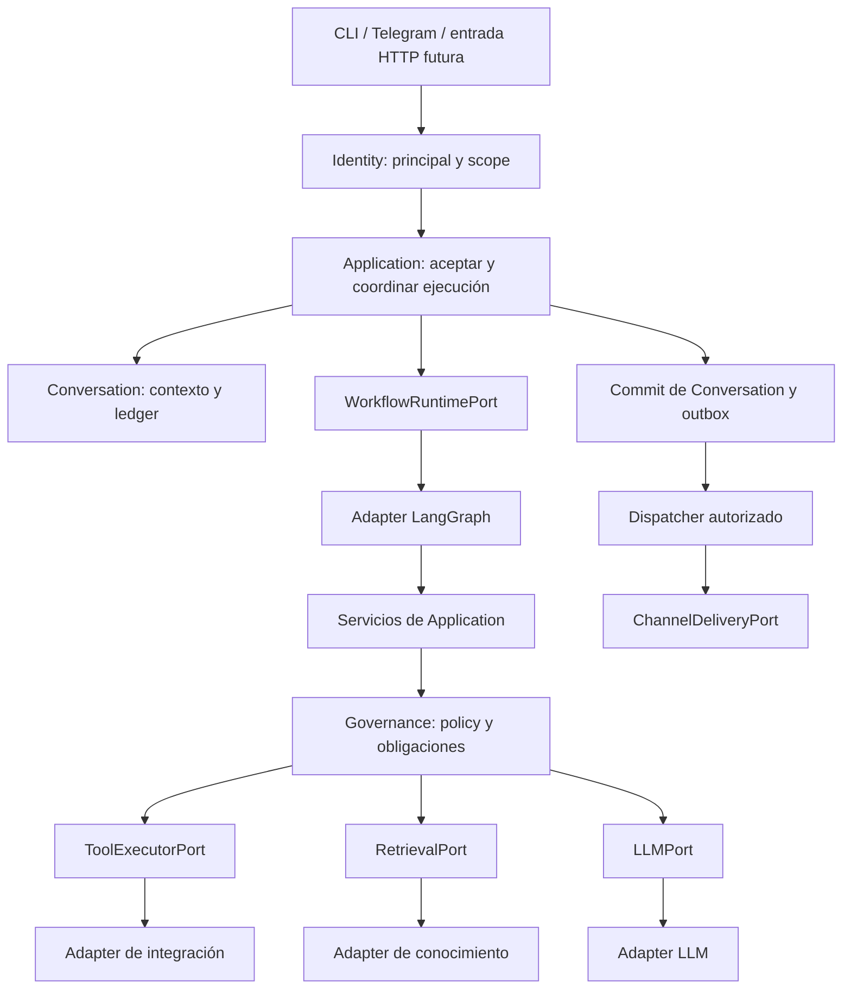
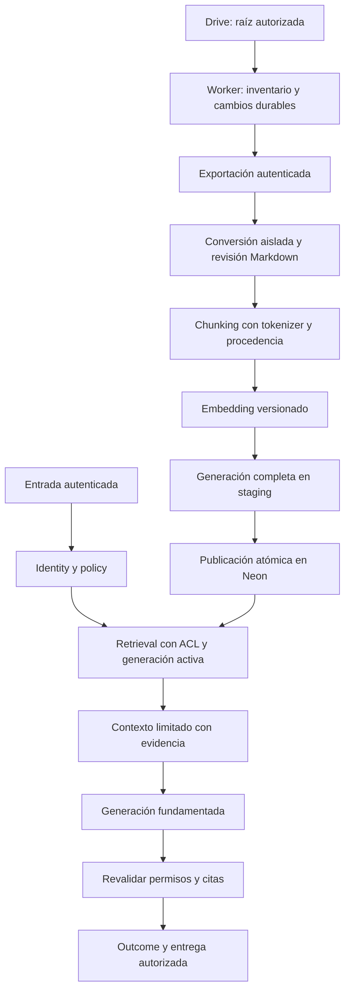

# Diseño técnico — etapa 3

Fecha: 2026-10-07. Diseño objetivo y buenas prácticas de implementación. Nombre de archivo conservado según la solicitud: `dessing.md`. Complementa [howto.md](howto.md), [BASE](BASE.md) y [PLAN-E3](PLAN-E3.md); no ratifica ADR abiertos ni declara capacidades implementadas.

## 1. Base real y cambios necesarios

| Componente actual | Observación del código | Trabajo E3 |
| --- | --- | --- |
| [composition.py](../../../src/incubia_orchestrator/bootstrap/composition.py) | Construye `HandleMessage` con scope y policy local. | Componer identidad, ledger y casos de uso compartidos. |
| [bot.py](../../../src/incubia_orchestrator/interfaces/cli/bot.py) | Inyecta generación fake y exige dos bindings de piloto. | Conectar Application mediante bootstrap, con configuración E3 explícita. |
| [HandleInbound](../../../src/incubia_orchestrator/modules/orchestration/application/use_cases/handle_inbound.py) | Genera UUID nuevos; transmite history del contexto construido. | Recibir IDs de inbox y transportar contexto/evidencia mediante contrato completo. |
| [TelegramRunner](../../../src/incubia_orchestrator/modules/conversation/adapters/channels/telegram/runner.py) | Lee `_connection` y coordina recepción/generación/entrega. | Acceso por puertos y coordinación reutilizable de Application. |
| [SqliteLedger](../../../src/incubia_orchestrator/modules/conversation/adapters/persistence/sqlite_ledger.py) | `complete` guarda turno con conversation_id vacío y no actualiza revisión canónica. | UoW que finalice conversación/outcome/inbox/outbox con scope y revisión reales. |
| [Policy engine](../../../src/incubia_orchestrator/modules/governance/adapters/policy/in_process/engine.py) | Recurso autorizado actual: LLM configurado localmente. | Policy explícita por operación, recurso, membresía, rol y scope. |
| [Grafo](../../../src/incubia_orchestrator/modules/orchestration/adapters/runtime/langgraph/graph.py) | Selección y generación; no implementa tools/RAG/loop general. | Conectar servicios de Application con límites de ejecución. |

Gate A es evidencia del alcance E2 documentado. Las propiedades adicionales de esta tabla se demuestran en E3 antes de declarar persistencia compartida o aislamiento completo.

## 2. Estructura y dirección de dependencias



El diagrama representa el recorrido de ejecución. Las importaciones siguen [spec 01](../../specs/01-estructura.md): Domain define invariantes; Application consume contratos/puertos; adapters traducen tecnología; bootstrap instancia las implementaciones. Los nodos del runtime reciben servicios y nunca construyen clientes concretos.

Cada contexto es dueño de sus datos. Conversation conserva historia/ledger; Identity/Tenant resuelve autoridad; Governance evalúa policy; Orchestration coordina capabilities/tools; Knowledge ingesta/recupera; Sales/Support registran leads/cases; Audit conserva eventos propios. Compartir PostgreSQL no permite que un módulo escriba las tablas privadas de otro.

La instrumentación en `foundation/telemetry.py` prevista por el plan debe limitarse a contratos realmente compartidos; los exporters concretos pertenecen a adapters/infraestructura. Evitar convertir `foundation` en un directorio de utilidades o proveedores.

## 3. Identidad, scope y contratos

`ExecutionScope` conserva deployment, tenant, conversation y actor. Todos los contratos protegidos reciben scope resuelto en servidor. Un identificador recibido del usuario es un recurso solicitado que se valida contra la autoridad del principal.

El lookup inicial de binding requiere una frontera privilegiada estrecha: resolver la cuenta/canal/remitente autenticados a una membresía. No usar una consulta arbitraria cross-tenant ni conceder `BYPASSRLS` al runtime para hacer ese lookup. La opción concreta de repositorio/función de resolución se revisa en E3-02/06.

| Identificador | Semántica / persistencia |
| --- | --- |
| Clave de inbox | Identifica el evento externo; se reserva una sola vez. |
| request_id / execution_id | Identidad lógica asignada al aceptar, conservada en replay. |
| conversation_id | Conversación canónica persistente entre turnos. |
| response_id | Respuesta lógica estable registrada antes de delivery. |
| tool_call_id | Operación lógica de tool dentro de ejecución; estable en retries. |
| attempt_id | Intento físico nuevo para diagnóstico, no reemplaza identidad lógica. |
| claim_generation | Generación monotónica de dueño para rechazar escrituras obsoletas. |

Definir contratos como valores tipados con versión, invariantes y errores propios. Evitar campos `dict[str, Any]` para payloads de negocio; cada capability tiene su input/output. Los estados discriminados exigen campos coherentes: éxito con output, denegación con razón pública segura, fallo con error tipado. Traducir excepciones de proveedor al salir del adapter.

Referencia conceptual del nuevo contrato de entrada; no es código ejecutable:

```python
AcceptedExecution(
    event_key=...,
    request_id=...,
    execution_id=...,
    scope=trusted_scope,
    input=typed_input,
)
```

Application no crea otros request/execution IDs al recibir este valor. `WorkflowRuntimePort` y `LLMPort` reciben contratos propios; GraphState/checkpoints quedan privados. Los facts/evidencias deben llegar explícitamente al request de generación, y solo sus campos públicos permitidos salen por ResponseContextPort.

## 4. Datos, claves y unidad de trabajo

Propuesta de claves a cerrar en E3-02; conservar compatibilidad/mapeo con datos E2:

| Registro | Identidad y restricciones mínimas |
| --- | --- |
| Inbox | UNIQUE(deployment, tenant, channel, account, external_event_id); hash de payload inmutable. |
| Conversación | Clave scoped por deployment/tenant/conversation; preservar la dimensión actor del esquema E2 o modelar participantes mediante decisión explícita. |
| Turno/outcome | Una incorporación por execution_id dentro de scope; FK al evento/conversación correspondiente. |
| Outbox | Respuesta/destino lógicos únicos y scope explícito o relación scoped obligatoria. |
| Tool call | UNIQUE(deployment, tenant, execution_id, tool_call_id); intentos en registros separados. |
| Fuente/chunk | Tenant/deployment, source/version e identidad de chunk; versión de embeddings/índice. |
| Lead/case | UNIQUE(deployment, tenant, execution_id, tipo_lógico); permiso y consentimiento para lead, regla autorizada de fallback para case. |

Claves foráneas compuestas impiden referenciar una conversación/fuente de otro tenant. El actor también debe poder acceder al recurso dentro de su propio tenant. IDs globalmente únicos no reemplazan los predicados de autorización.

El protocolo mantiene estas fronteras transaccionales:

```text
Transacción corta A:
  reservar evento y snapshot de identidad, o registrar descarte justificado
  persistir su disposición y cursor Telegram juntos → commit de aceptación

Transacción corta de procesamiento:
  adquirir claim → leer revisión

Fuera de transacción:
  revalidar autoridad → reservar presupuesto/audit → ejecutar LLM/tool/retrieval
  construir outcome y respuesta pública

Transacción corta B:
  comprobar scope + dueño + generación + vigencia + revisión esperada
  añadir turno y actualizar revisión
  guardar outcome + outbox + inbox COMPLETED + evidencia local de commit
  commit conjunto

Dispatcher:
  revalidar destino/autoridad → reservar delivery → enviar → registrar resultado
```

El UoW abre una conexión/transacción compartida por repositorios participantes de Conversation. Un repositorio no hace commits ocultos dentro de esa unidad. Si la revisión/token no coincide, se revierte todo y se clasifica el conflicto; no repetir automáticamente todo el workflow si ya llamó proveedores.

Si se corta la conexión al confirmar el commit, tratar el resultado como desconocido y consultar por la identidad lógica antes de reprocesar. La BD y Telegram no comparten una transacción; completar en BD no prueba que el mensaje llegó.

Para lead/case de otro contexto: invocar su caso de uso con idempotencia y registrar el resultado. Un crash después de su commit se recupera consultando esa misma clave. Una exigencia futura de atomicidad entre contextos requiere una decisión explícita; no sumar commits independientes y llamarlos atómicos.

## 5. PostgreSQL/Neon y aislamiento de conexiones

Neon es la elección relacional local de [ADR-025](../../adr/ADR-ORCH-025-NEON-POSTGRESQL-TIER-3.md). Driver, migrador y versión de PostgreSQL se fijan al implementar. Mantener consultas parametrizadas, transacciones cortas, pool por proceso limitado y timeout de adquisición dentro del deadline del turno. Ninguna llamada de red al proveedor retiene la conexión de la transacción anterior.

El runtime usa un rol sin superuser, sin `BYPASSRLS` y sin ownership de tablas. RLS debe comprobar lectura y escritura (`USING`/`WITH CHECK`); el propietario normalmente elude RLS, salvo `FORCE ROW LEVEL SECURITY`. Esa cláusula no limita superusuarios ni roles con bypass. Verificar con el rol runtime real. [Políticas RLS de PostgreSQL](https://www.postgresql.org/docs/18/ddl-rowsecurity.html).

Propuesta de contexto de sesión acotado a transacción, implementada únicamente dentro del adapter después de autenticar/resolver scope:

```sql
BEGIN;
-- $1 y $2 son valores enlazados por el driver, nunca texto SQL interpolado.
SELECT set_config('app.deployment_id', $1, true);
SELECT set_config('app.tenant_id', $2, true);
-- Las consultas scoped y la policy RLS comparten esta transacción/conexión.
COMMIT;
```

`set_config(..., true)` dura la transacción; `current_setting(..., true)` devuelve NULL si el parámetro no existe. La policy debe denegar contexto ausente/vacío, sin tenant por defecto. [Funciones de configuración PostgreSQL](https://www.postgresql.org/docs/18/functions-admin.html#FUNCTIONS-ADMIN-SET).

Esto complementa la autorización de Application: una variable de conexión no autentica por sí misma al actor. El cliente no puede controlar esos valores, SQL o credenciales runtime. Probar la secuencia tenant A → tenant B → sin scope en una conexión reutilizada, incluyendo rollback; probar actor ajeno dentro del mismo tenant.

Las migraciones usan credenciales operativas y conexión directa separadas del tráfico runtime, conforme a [conexión oficial Neon](https://github.com/neondatabase/website/blob/main/content/docs/get-started/connect-neon.md). Para el pool elegido, comprobar soporte de las características de sesión que use el driver; no depender de locks de sesión persistentes para ser dueño de un bot. Validar en staging el comportamiento de la misma configuración que tendrá el servicio.

## 6. Claims, concurrencia y efectos inciertos

Claim propuesto: `resource_key`, `owner_id`, `generation`, `expires_at`, `state`. Adquisición/renovación/finalización se comparan atómicamente usando tiempo de BD. La vigencia se comprueba junto al token; una transacción de finalización bloquea/valida la fila pertinente antes de modificar la conversación y outbox.

El token protege escrituras locales. Un proveedor externo normalmente no lo conoce: no impide que un proceso pausado envíe tarde. Evitar takeover automático que repita un envío incierto; detener o reconciliar el dueño previo y mantener UNKNOWN_EFFECT cuando no haya certeza. La unicidad del consumidor Telegram requiere además una política operativa de pérdida/transferencia de ownership validada antes de multi-host.

| Situación | Resolución |
| --- | --- |
| Evento duplicado, mismo hash | Devolver IDs/estado existentes. |
| Misma clave, payload diferente | IdempotencyConflict; ningún procesamiento nuevo. |
| Dos workers, misma conversación | Una reserva vigente y control de revisión para impedir lost update. |
| Dueño obsoleto intenta finalizar | Rechazar todas sus escrituras finales. |
| PROCESSING vencido | NEEDS_INSPECTION o recuperación explícita validada; no asumir trabajo puro. |
| SENDING tras caída o timeout ambiguo | UNKNOWN_EFFECT, sin retry automático. |
| SENT repetido | Consultar resultado; cero reenvío. |

El `recover()` SQLite actual reclasifica globalmente PROCESSING/SENDING bajo dueño único. En PostgreSQL solo se recupera trabajo de dueños inválidos; reiniciar una réplica no reclasifica el trabajo vivo de las demás. Los contadores de intentos, expiraciones y estados se persisten y auditan.

## 7. Tool Layer y política de ejecución

Discovery entrega candidatos elegibles; selection aplica una regla estable. El executor valida la propuesta y aplica PEP/PDP a operación/recurso/actor actuales. DENY, INDETERMINATE, REQUIRE_APPROVAL o una obligación sin cumplir detienen la operación antes de llamar al adapter.

Orden obligatorio del primer slice: validar schema/scope → comprobar política y obligaciones → reservar presupuesto e intención auditada → invocar adapter → validar output → registrar resultado/evidencia. La persistencia del audit crítico precede a la operación, con transacción corta cerrada antes de red. Credenciales solo se resuelven en infraestructura.

Cada tool declara READ/MUTATION/EXTERNAL_ACTION, semántica de idempotencia, reversibilidad y disponibilidad. La guía implementa READ; ADR-021 gobierna efectos empresariales nuevos. Una respuesta de tool es dato no confiable: no activa otras herramientas ni modifica permisos.

El deadline es absoluto para la ejecución. Cada paso calcula tiempo restante y asigna un máximo acotado; cada retry consume el mismo cupo de intentos/presupuesto. SDK y executor no pueden multiplicar retries entre sí. Error de schema, denegación, secreto ausente y efecto incierto no disparan retry genérico. Valores iniciales y casos están en [TOOLING](TOOLING.md).

## 8. Knowledge, contexto y salida pública

ADR-010 fija Neon/PostgreSQL con pgvector y una base de Knowledge por deployment. Source → versión → chunks → generación de índice son entidades de esa base. Mantener la generación anterior activa durante una ingestión nueva; publicar la nueva solo después de completarla. Validar hash, dimensión y modelo de embeddings; no mezclar espacios vectoriales incompatibles. La búsqueda exacta por coseno es baseline; HNSW se habilita por feature flag sólo con evidencia.

Resolver el deployment confiable antes de abrir una conexión: la base, credenciales y pool son la frontera de aislamiento entre clientes. Filtrar permisos de documento, rol o departamento antes de seleccionar evidencia cuando apliquen. Para caches, incluir deployment, generación, policy y versiones; la revocación invalida resultados y exige revalidación antes de usar evidencia pendiente. La información confidencial deja de ser utilizable incluso si ya estaba en un snapshot de ejecución.

`EvidenceItem` contiene referencia, versión, instante y contenido permitido. ContextBuilder asigna presupuesto a instrucciones, mensaje, hechos, evidencia y pares recientes. El contrato LLM transporta esos valores de forma explícita; la respuesta pública conserva solo texto y referencias permitidas. Citar una fuente no valida una afirmación: medir soporte de hechos con la rúbrica de [AGENTES](AGENTES.md).

Sin evidencia suficiente o con fuentes incompatibles, devolver abstención o propuesta de caso. Un caso persistido no significa handoff humano ejecutado. La operación pgvector y métricas pertenecen a [KNOWLEDGE](KNOWLEDGE.md) y [GOALS](GOALS.md).

## 9. Buenas prácticas de implementación y validación

| Práctica | Aplicación concreta |
| --- | --- |
| Dependencias hacia contratos | Extender tests de arquitectura a Conversation, Identity, Knowledge, Audit, Sales y Support; cubrir SQL/SDKs. |
| Tipos y errores explícitos | Un error de negocio no expone traceback ni excepción de proveedor. |
| Configuración estricta | Versiones/claves desconocidas fallan al arrancar; secreto ausente no cambia silenciosamente a otro backend. |
| Idempotencia en almacenamiento | Constraints + CAS/revisión, sin secuencias consultar-luego-insertar desprotegidas. |
| Recursos limitados | Deadline global, pool acotado, máximos de payload/contexto/steps y presupuesto durable. |
| Observabilidad útil | IDs en eventos/logs; métricas agregadas con cardinalidad acotada, sin execution_id como etiqueta métrica. |
| Tests por comportamiento | Replay, concurrencia, revocación, fallos de commit, contenido adversarial y restore; clocks/IDs inyectables. |
| Migración revisable | Cambios aditivos compatibles primero; retirar campos después del corte y evidencia de lectura/migración. |

Separar audit de producto durable de telemetría operativa exportable. Logs por defecto sin prompts/transcripciones/DSN. Sanitizar errores y comprobar secretos canario. Registrar modelo, versión, calls, usage, tiempo y costo conocido; “desconocido” no es cero.

La suite offline actual bloquea sockets y parte de los subprocesos. Configurar suites DB/remotas explícitas con límites; una prueba PostgreSQL nunca debe apuntar por defecto a la base de clientes. Incluir pruebas del bloqueo como parte del cambio de harness.

## 10. Decisiones y mantenimiento de las guías

Neon relacional y pgvector por deployment están seleccionados por ADR-025/010; driver/migrador, embeddings, proveedor READ, auth HTTP y plataforma de despliegue siguen sus tareas/decisiones. Estas guías no eligen herramientas adicionales por anticipado. Un cambio de contrato se refleja en BASE/GLOSARIO, su tarea PLAN-E3 y sus pruebas; un cambio de umbral se refleja en GOALS/VERIFICACION con justificación.

Los enlaces oficiales de PostgreSQL y Neon anteriores se consultaron al redactar. Verificar compatibilidad con la versión/plan elegidos durante E3-03. Para estado Linear usar [LINEAR-ADR](LINEAR-ADR.md); para operación y corte seguir [RUNBOOK](RUNBOOK.md). [howto.md](howto.md) conecta este diseño con el orden de implementación.

## 11. Diseño del RAG IncubiaLab

Revisión: 2026-10-21. Diseño propuesto para las tres entregas de [GOALS](GOALS.md#feature-rag-incubialab-tres-etapas-y-tres-entregas); implementación secuenciada en [howto](howto.md#10-howto-del-rag-incubialab). Se conserva el monolito modular y la decisión de [ADR-010](../../adr/ADR-ORCH-010-RAG-VECTOR-STORE.md): una base Knowledge por deployment. No se requiere otro framework RAG para completar este corte.

### 11.1 Base comprobada y brechas

| Código existente bajo `src/incubia_orchestrator` | Reutilizar / extender |
| --- | --- |
| `modules/knowledge/domain.py` | Source y EvidenceItem limitan texto a 4096 bytes; separar documento y chunks, añadir procedencia y ACL. |
| `modules/knowledge/application/ingest.py` | Hoy rechaza source_id repetido y embebe un contenido por Source; extender a varios chunks por versión. |
| `modules/knowledge/adapters/postgres.py` | 384 dimensiones, publicación completa, revocación y rollback existentes; ampliar ACL, staging por lotes y snapshot vacío. |
| `modules/knowledge/adapters/local_embedding.py` | Reutilizar revisión fijada; comprobar tokenizer real y longitud efectiva. |
| `modules/knowledge/adapters/pool.py` | Mantener selección por deployment y limitar conexiones agregadas. |
| `bootstrap/e3_grounded.py` y `modules/orchestration/application/grounded_workflow.py` | Composición READ/retrieval existente; incorporar fuente IncubiaLab, autorización y citas privadas. |
| `migrations/knowledge/001_knowledge.sql`, `002_hnsw_opt_in.sql` (raíz) | Migración aditiva para versiones/ACL/sync; no reescribir migraciones ya aplicadas. |

En este checkout no se encontró un conversor `prepare_knowledge_markdown.py` ni un pipeline Drive. Se planifican como componentes nuevos, sin afirmar que el corpus real está conectado.

### 11.2 Flujo y límites de responsabilidad



Knowledge posee corpus/índices/sync; Identity resuelve actor y membresía; Governance decide acceso; Orchestration coordina; Conversation conserva outcome/outbox; Audit conserva trazabilidad. El worker tiene entrada operativa propia y reutiliza casos de uso, sin lógica de Drive dentro de nodos LangGraph. Proponer puertos `SourceCatalogPort`, `DocumentConverterPort`, `ChunkerPort`, `SourceAuthorizationPort` y `SyncCheckpointPort`; mantener EmbeddingPort/Retrieval existentes con contratos explícitos.

### 11.3 Modelo de datos objetivo

Nombres orientativos para la próxima migración; no son tablas disponibles hoy:

| Entidad | Identidad y campos/invariantes |
| --- | --- |
| Fuente | `source_id` = ID estable Drive; root, MIME, URI privada, estado, revoked_at, ACL version y authorization_checked_at. |
| Versión de documento | PK `(source_id, version_id)`; hashes original/Markdown, convertidor/pipeline, blob privado, revisión de extracción. `version_id` incorpora versión observada y hashes; un nombre o modifiedTime aislado no deduplica. |
| Chunk | PK `(generation_id, source_id, version_id, chunk_id)`; ordinal, breadcrumb/localizador, texto ≤4096 bytes, tokens efectivos, hash, vector y fingerprint. FK a versión exacta. |
| Generación | ID determinista del manifiesto completo + pipeline/modelo; BUILDING → VALIDATING → ACTIVE → RETIRED, o FAILED; una única ACTIVE por base mediante constraint/lock. |
| Membresía de generación | Fuente/versión y conjunto esperado de chunks; permite conservar documentos sin cambios y verificar completitud. |
| Grants | Fuente + principal interno/rol/grupo verificado + policy/ACL version + vencimiento; no almacenar emails como identificadores públicos. Denegación por defecto. |
| Sync job/checkpoint | Raíz + identidad Drive + cursor; jobs con clave idempotente, intento, lease/fencing, estado y error sanitizado. |

Acl y revocación son estado vigente independiente de versiones históricas: un rollback de generación nunca restaura autorización antigua. Constraints y transacciones deben evitar activación parcial o publicación por un worker que perdió el lease. Hashes de contenido no sustituyen autorización.

Guardar Markdown/exports en almacenamiento privado con permisos, retención y respaldo definidos. Neon guarda metadatos, texto de chunks y vectores; evitar duplicar binarios grandes. El borrado lógico bloquea uso inmediatamente al detectarse; la purga física y backups siguen la retención acordada.

### 11.4 Extracción y chunking

Markdown es una representación intermedia legible y revisable. Neon almacena vectores y texto; no exige Markdown ni hace chunking automáticamente. Preferir exportación nativa de Docs y conversión Python para Office/PDF. MarkItDown es candidato por formatos; OCR y fidelidad de tablas se evalúan con corpus real. Plugins desactivados no equivalen a sandbox: el proceso de conversión requiere aislamiento y límites propios. [Microsoft MarkItDown](https://github.com/microsoft/markitdown).

El chunker preserva jerarquía y procedencia; el tamaño se determina con el tokenizer del modelo. El MiniLM candidato declara 128 tokens y 384 dimensiones, por lo que 500 tokens por chunk sería incompatible con esa configuración. Fijar revisión y verificar el runtime antes de decidir tamaño final. [Model card](https://huggingface.co/sentence-transformers/paraphrase-multilingual-MiniLM-L12-v2).

Fingerprint propuesto: modelo + revisión + dimensión + tokenizer + normalización + formato de prefijo. El ID del chunk combina fuente/versión, versión de chunker, ordinal y hash. Cambiar formato o modelo crea una generación distinta. Consultas demasiado largas se rechazan o se procesan por una estrategia explícita evaluada; nunca truncación silenciosa.

### 11.5 Transacciones y publicación

La conversión y las llamadas de embeddings ocurren sin conexión SQL retenida. Persistir staging en transacciones breves e idempotentes. Al publicar: tomar lock de generación, verificar fencing, modelo, conteos/hashes y revisión ACL actual, retirar la anterior y activar la nueva en una sola transacción. Si el commit es incierto, consultar por generation_id antes de repetir. La versión inicial conserva el snapshot completo lógico; no activar un lote incremental aislado.

Neon usa pooling de transacciones: no depender de variables de sesión entre solicitudes. Usar configuración local a la transacción cuando aplique y conexión directa para operaciones que necesiten sesión persistente. Limitar pool local además del pool del proveedor y liberar conexión antes del LLM. [Neon pooling](https://neon.com/docs/connect/connection-pooling). La versión de psycopg fijada en pyproject gobierna implementación; no copiar APIs nuevas de documentación dev sin verificar compatibilidad.

### 11.6 Autorización y recuperación

La base por deployment evita cruce entre clientes; dentro de la base, permisos de fuente restringen actor/tenant. Permiso efectivo = policy de aplicación ∩ acceso documental verificado ∩ pertenencia a raíz ∩ vigencia. El acceso del ingestor no demuestra acceso del actor. Grupos/dominios/permisos heredados necesitan resolución verificable; información incompleta produce denegación, sin conceder acceso general por email parecido. [Modelo de permisos Drive](https://developers.google.com/workspace/drive/api/guides/manage-sharing).

La consulta SQL aplica generación activa, modelo, no revocación y grants vigentes antes de LIMIT. Usar parámetros SQL y un resolver DSN confiable; no concatenar IDs o nombres de tabla del prompt. Los únicos chunks enviados al LLM son autorizados. Revalidar al terminar generación y al despachar outbox; descartar texto completo que dependa de una fuente revocada, no sólo quitarle el enlace.

Búsqueda exacta por coseno primero. El operador `<=>` da distancia; el score derivado no es confianza. HNSW puede perder recall con filtros: medir contra exacta y habilitar búsqueda iterativa sólo si versión instalada y plan SQL la soportan. No forzar índices permanentemente para aparentar rendimiento. [pgvector](https://github.com/pgvector/pgvector#filtering).

Si falta recall en consultas de códigos/nombres, experimentar en dev con búsqueda léxica PostgreSQL y fusión de rankings; aplicar idénticas ACL a ambas ramas. Reranker/híbrido son ampliaciones condicionadas a evidencia, no dependencias iniciales. Su costo/latencia y top-k final deben caber en GOALS.

### 11.7 Contexto, citas e inyección

Contexto contiene instrucciones confiables separadas de evidencia no confiable, delimitada y presupuestada. Texto de Drive nunca modifica policy, scope o tool arguments por sí mismo. Sólo el executor autorizado puede producir efectos. Probar documentos que ordenen revelar secretos, cambiar instrucciones o leer otras fuentes; filtros de texto no bastan como frontera de seguridad. [OWASP](https://cheatsheetseries.owasp.org/cheatsheets/LLM_Prompt_Injection_Prevention_Cheat_Sheet.html).

La respuesta usa identificadores de evidencia que el servidor resuelve a referencias autorizadas, con fuente/versión y localizador real. Un enlace HTTPS no convierte un documento en público. Verificar existencia, autorización y soporte de cada cita. Si la evidencia falta, contradice otras fuentes o fue revocada, abstenerse o expresar el límite sin inventar una política empresarial. Evaluar soporte manualmente; una cita existente puede no respaldar la afirmación.

### 11.8 Operación y recuperación

Drive Changes alimenta trabajos durables; el checkpoint avanza sólo cuando la página quedó registrada. La aplicación mantiene pertenencia recursiva a raíz y reconciliación completa periódica. Un cambio de carpeta afecta descendientes; un cambio ACL puede necesitar resolver herencia/grupos sin cambio de texto. [Changes API](https://developers.google.com/workspace/drive/api/guides/manage-changes).

Frescura y autorización tienen relojes separados: contenido puede esperar reindexación; una revocación conocida invalida inmediatamente. Cumplir expiración de permisos aunque el worker esté caído. Cache keys incluyen deployment, tenant/actor o digest de permisos, ACL/policy version, generación, modelo y consulta; no servir caché con autorización vencida.

Rollback cambia índice, conserva revocaciones. Restore recupera datos en base aislada y revalida permisos antes de tráfico. Branches y copias también requieren retención y control de acceso. Registrar RPO/RTO medidos y uso monetario real/conocido; costo desconocido no es cero. Audit crítico bloquea operación si no puede registrarse; falla del exporter métrico no invalida un commit durable.

### 11.9 Trazabilidad de implementación y decisión

| Entrega | Componentes a desarrollar | Riesgo que debe demostrar la prueba |
| --- | --- | --- |
| V1 | Drive adapter, conversor CLI, manifiesto, preflight Neon | Pérdida de contenido, raíz ajena, ACL desconocida, privilegios excesivos. |
| V2 | Contratos multichunk, migración, chunker, ingestión, ACL/retrieval/citas | Generación parcial, modelo incompatible, fuga antes del LLM, respuestas sin soporte. |
| V3 | Sync durable, leases, cachés, audit, composición y runbook | Pérdida de cambios, permiso obsoleto, recuperación que reactive datos revocados, gasto no reconciliado. |

Fuentes consultadas el 2026-10-21: documentación oficial de Neon, Google Drive, ficha del modelo, repositorios mantenidos por pgvector/Microsoft y OWASP, enlazados junto a cada decisión. El esquema, etapas, límites y contratos propuestos son decisiones de este proyecto; las fuentes no acreditan que ya estén implementados. Registrar versión/commit de cada dependencia al implementarla y reevaluar estos supuestos con los resultados de cada entrega.
