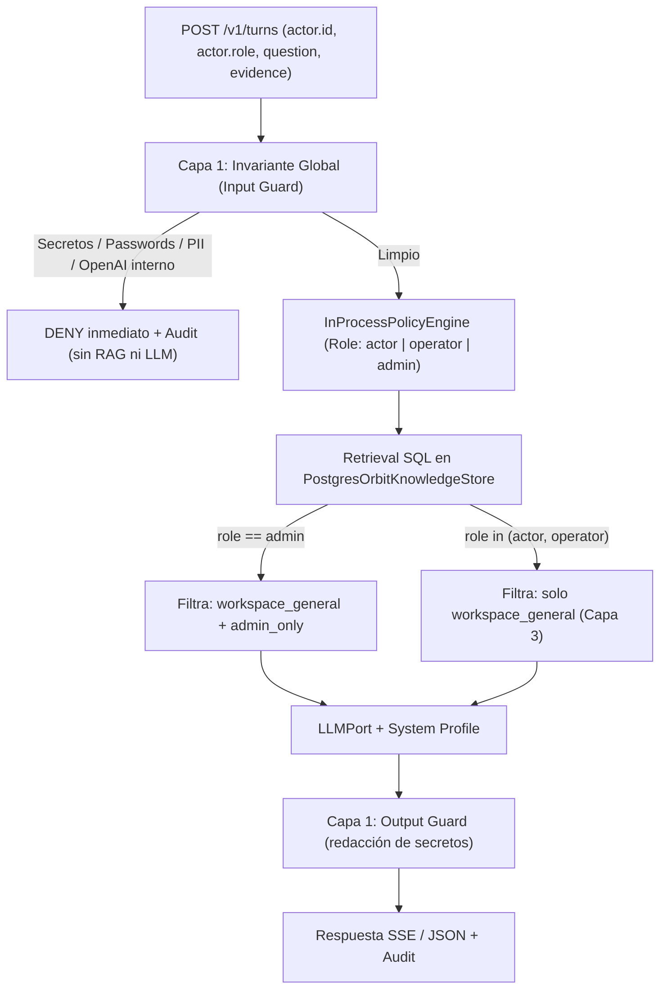

# DESSIGN — Diseño Técnico de Políticas de Control en 3 Capas

Fecha: 2026-11-12
Relacionado: [GOALS.md](GOALS.md) · [ROADMAP.md](ROADMAP.md) · [howto.md](howto.md) · [TODOS.md](TODOS.md)

> Nota: El nombre `DESSIGN.md` sigue la convención solicitada para el paquete de planificación (análogo a `etapa-3/dessing.md`).

## 1. Modelo de 3 Capas (RBAC acumulativo + Invariante global)

### Definición de cada capa

1. **Capa 1 — Bloqueo Global (`ALL_ROLES_DENIED`):**
   - **Aplica a:** `actor`, `operator` y `admin` sin excepción.
   - **Alcance:** Solicitudes de contraseñas, credenciales, tokens, API keys (`sk-`, `npg_`, DSNs), información personal/sensible de usuarios, prompts internos de sistema y configuración interna de OpenAI.
   - **Mecanismo:**
     1. *Input Guard* determinista en `governance/domain/` previo a RAG y LLM.
     2. *Output Guard* determinista previo a emitir respuesta (redacción/abortado si aparece un patrón de secreto).
     3. Regla explícita en el perfil del especialista (`config/e2/profiles/`).

2. **Capa 2 — Restringido (`admin_only`):**
   - **Aplica a:** Exclusivamente `Role.ADMIN`.
   - **Alcance:** Requerimientos, NFRs (información de clientes), documentación legal, documentos corporativos sensibles de empresa e información de clientes en Drive.
   - **Mecanismo:** Pre-filtrado obligatorio en SQL antes de construir el contexto del LLM.

3. **Capa 3 — Operativo General (`workspace_general`):**
   - **Aplica a:** `Role.ACTOR`, `Role.OPERATOR` y `Role.ADMIN` (modelo acumulativo vía `role_at_least(actual, required)`).
   - **Alcance:** Información de Linear (proyectos, milestones, issues, ADRs), manuales de uso, brandbooks y stacks tecnológicos de Drive.

## 2. Brechas actuales en el código que resuelve este diseño

| Archivo actual | Situación observada | Cambio requerido |
| --- | --- | --- |
| `src/incubia_orchestrator/interfaces/http/service.py` | `validate_orbit_turn` exige `set(actor) == {"id"}`; no recibe `role`. | Aceptar `role` (`"actor" \| "operator" \| "admin"`) validado desde Orbit BFF; fail-closed si viene inválido. |
| `src/incubia_orchestrator/bootstrap/vps.py` | `LangGraphOrchestrationRuntime.execute` instancia `InProcessPolicyEngine` sin `membership_port` ni `role` del actor. | Pasar `role` efectivo al `PolicyQuery` / `Authority` y registrar denegaciones en `PostgresAuditLog`. |
| `src/incubia_orchestrator/modules/knowledge/domain.py` | `DocumentSyncRequest` y `WorkspaceKnowledgeHit` no modelan nivel de acceso (`access_tier`). | Incorporar `AccessTier` (`WORKSPACE_GENERAL`, `ADMIN_ONLY`) con default seguro en validación (`ADMIN_ONLY` si no se declara o rechazo explícito). |
| `src/incubia_orchestrator/modules/knowledge/adapters/postgres_documents.py` | `search_workspace` filtra solo por `orbit:<workspace_id>:%` y `revoked_at IS NULL`. | Filtrar en SQL por `access_tier` permitido según el `Role` del solicitante **antes** del `LIMIT top_k`. |

## 3. Reglas de arquitectura y seguridad (Hexagonal + Fail-Closed)

1. **Sin dependencias externas en `domain/` ni `application/`:** Las reglas deterministas de Capa 1 y el enum `AccessTier` viven en `modules/governance/domain/` y `modules/knowledge/domain.py`.
2. **Pre-filtrado en almacenamiento, nunca solo en prompt:** Un chunk de Capa 2 nunca debe llegar a la ventana de contexto del LLM si el usuario no es `Role.ADMIN`.
3. **Fail-closed por defecto:**
   - Si `access_tier` es desconocido o nulo en BD -> tratar como `admin_only`.
   - Si `actor.role` falta o es inválido en `/v1/turns` -> rechazar con `400`/`403` (o degradar únicamente si se define explícitamente en contrato; nunca asumir `admin`).
   - Si `PostgresAuditLog` falla al registrar una denegación -> abortar sin ejecutar LLM/RAG (`ADR-ORCH-014`).
4. **Cero secretos en logs y auditoría:** Registrar `decision_id`, `reason_code` (ej. `CAPA1_SECRET_REQUEST_DENIED`), `actor_id`, `role`, `policy_revision`; nunca el texto crudo de la pregunta si disparó Capa 1.

## 4. Evolución de esquema (PostgreSQL Knowledge)

- Toda migración en `migrations/knowledge/` debe ser **forward-only** (*expand/contract*, verificada por `tests/unit/test_e3_migration_rollback.py`).
- Opción recomendada: añadir columna `access_tier TEXT NOT NULL DEFAULT 'admin_only'` en `knowledge_sources` (con `CHECK (access_tier IN ('workspace_general', 'admin_only'))`) e índice compuesto por `(deployment_id, access_tier)` o consulta sobre `source_id` + `access_tier` para que el pre-filtrado sea exacto y rápido.

